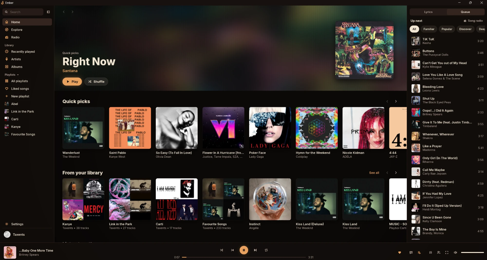
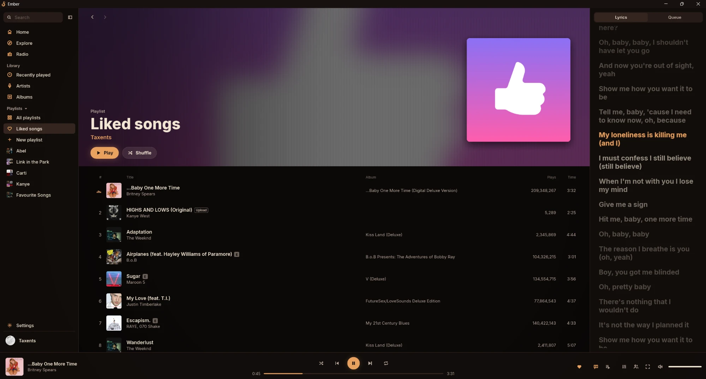
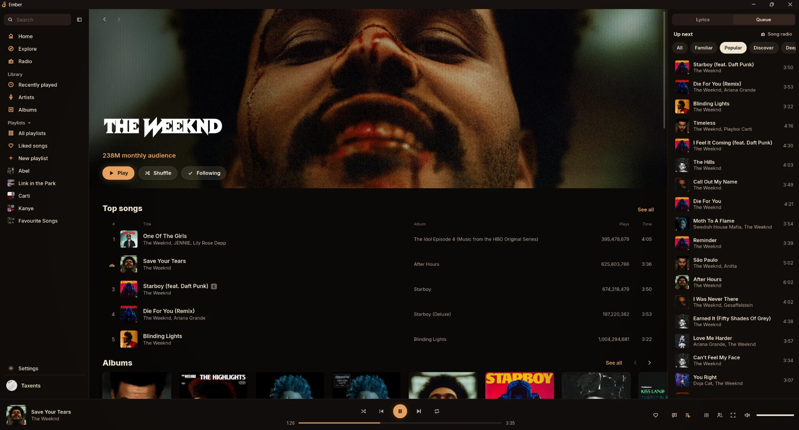
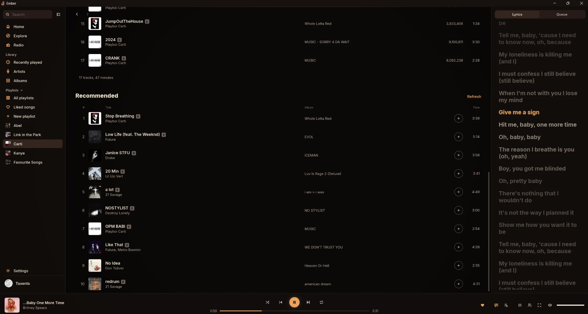

# Ember

Free optimized music player for Windows

## Fast

Always under 180 MB of RAM

Trims usage when minimized. Even with music playing it uses 0% CPU, 0% GPU and under 5 MB of RAM
## Features

Lyrics follow along word by word, in the side panel or full screen

Advanced autoplay keeps the music going in the direction you pick

Playlists come with recommended songs to add

Listen Along with friends, perfectly in sync

10 band equalizer with presets for bass, vocals and treble

## Download

Get EmberSetup.exe from the [latest release](https://github.com/Taxents/Ember/releases/latest). It updates itself after that.
